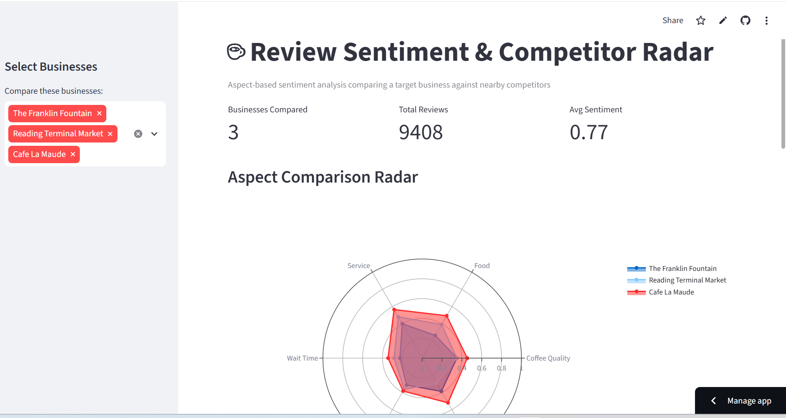
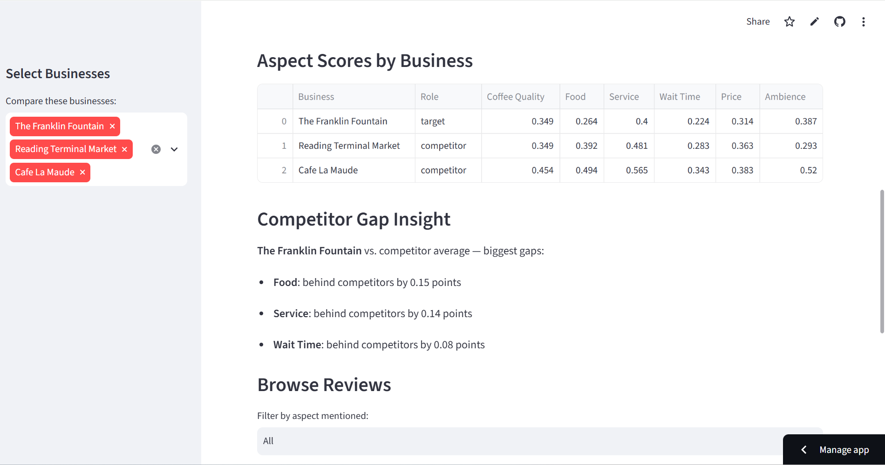

# Review Sentiment & Competitor Radar

Aspect-based sentiment analysis comparing a local business against nearby competitors, built from real Yelp review data.

**🔗 Live app:** (https://review-sentiment-radar-iyxpjovmbfqcbyeuzk3ifs.streamlit.app/)



## Problem

Small businesses collect hundreds of reviews but have no time to read them all. This tool reads every review, scores sentiment across six specific aspects (coffee quality, food, service, wait time, price, ambience), and shows exactly where a business is losing to its competitors — in one chart.

## Who it's for

Local business owners who want a fast, visual answer to: *"What should I fix first to compete better?"*

## How it works

1. **Data source:** Yelp Open Dataset (academic/research license) — 150,346 businesses, 6.99M reviews across 11 metro areas.
2. **Scope:** 6 coffee shops and cafes in Philadelphia — 1 target business + 5 nearby competitors, chosen by review volume and proximity.
3. **Sentiment scoring:** VADER (rule-based sentiment analysis) for overall tone, plus a keyword-matching system that tags each sentence to one of six aspects and scores it independently.
4. **Dashboard:** Built with Streamlit and Plotly — radar chart comparison, aspect score table, automated gap analysis, and a filterable review browser.

## Architecture

Yelp JSON files → load_yelp.py → SQLite (reviews.db) → analyze.py (VADER + aspect scoring) → app.py (Streamlit dashboard)

## Key finding

The target business (The Franklin Fountain) scores lowest relative to competitors on **Food (-0.15)**, **Service (-0.09)**, and **Wait Time (-0.07)** — a clear, specific place to focus improvement.



## Tech stack

Python · Streamlit · Plotly · pandas · SQLite · VADER Sentiment

## Limitations

- Aspect scoring uses keyword matching + VADER rather than an LLM, due to API cost constraints — a reasonable tradeoff for a free, fast, and fully explainable method.
- The Yelp Open Dataset only covers 11 fixed metro areas (not every city), so the live demo uses Philadelphia rather than the business owner's actual city.
- A live-lookup mode using Google Places API was scoped but not included in this version due to Google's 5-review-per-business limit making it too thin for meaningful analysis.

## Next steps

- Add a sentiment-over-time trend chart
- Swap keyword-based aspect scoring for LLM-based scoring (budget permitting)
- Add a live single-business lookup mode via Google Places API

## Run it locally

```bash
git clone https://github.com/BhargaviGudisa/review-sentiment-radar.git
cd review-sentiment-radar
python -m venv venv
venv\Scripts\activate
pip install -r requirements.txt
streamlit run app.py
```